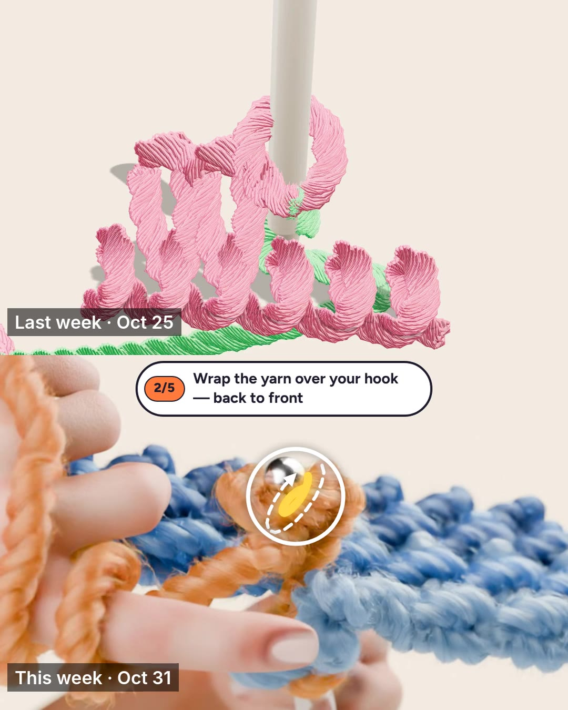
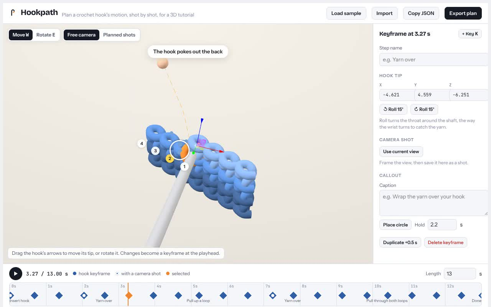

# Single crochet, last week and this week

- `sc-pink-vs-now-4x5.mp4`: 1080×1350, for Instagram/Threads
- `sc-pink-vs-now-wide.mp4`: 1600×500, side by side
- `hookpath-demo.mp4`: Hookpath, the keyframe tool, playing the single crochet plan with its planned camera shots

Both halves show the same five steps. The Oct 31 half (commit `afb27fb`) is recorded from the app's Learn
modal, so it has the guided annotations the app draws over the video: the step caption, the
ring and arrow, the stitch numbers, and a 2.4 s freeze on each callout. The Oct 25 video
(`assets/tutorials/sc.mp4`, commit `2bc5181`, captured from the live three.js scene) is
retimed to the same step clock (`assets/tutorials/sc.cues.json` → `timeline`) and holds still
during each freeze, so each step lines up on screen.

---

On October 25, the **Learn this stitch** button played a capture of the live three.js scene:
pink twisted yarn, a bare grey hook, a green working strand, and a fixed camera.

Six days and 137 commits later, the same button plays a Blender Cycles render. The yarn has
three plies wrapped in hundreds of tapered fibres. Real hands hold the hook and the work. The
camera films the stitch the way a person teaching it would, and freeze-frames point at where
the hook goes.

Here is what changed and what we learned about splitting the work between a person and an AI.

## How it got here

1. **Jun 16 · A drawing.** 2D canvas, five steps at one second each.
2. **Jun 16–22 · Physics in the browser, then a revert.** Verlet yarn, a rigged glTF hand,
   Blender-baked cloth drape. The yarn came out lumpy and the motion got harder to read, so
   we reverted to the clean geometric version (`a32a1cd`). Knowing when to back out was part
   of the work.
3. **Oct 16 · Real choreography, live.** The hook goes in, yarns over, pulls up and pulls
   through in three.js. Close camera, light backdrop, and working yarn in a contrasting
   colour so you can follow it.
4. **Oct 24 · Yarn that looks like yarn.** Photo-based fibre maps and lighting from a Blender
   yarn tutorial (below).
5. **Oct 25 · Leave the browser.** A handoff doc split the job into Route A (capture the live
   scene, the safety net) and Route B (render offline in Blender Cycles, the real goal). Then
   came a choreographed single crochet in blue and orange teaching colours, a guided camera
   and MakeHuman hands.
6. **Oct 26 · Hookpath.** A tool for planning the hook's motion by hand (below).
7. **Oct 27–31 · Rounds and rounds of feedback.** Each note was logged word for word with the
   fix it led to.

## Hookpath

It's hard to describe 3D motion in words. "Tip the head up behind the work" can mean a dozen
different poses. So instead of writing more prompts, we built a small browser tool
(`tools/hookpath/`):

- Drag or rotate the hook. Each change becomes a keyframe on a timeline.
- Give each keyframe a step name ("Yarn over"), a camera shot ("Use current view") and a
  callout (a caption plus a circle you click into the scene).
- Play it back with a free camera or the planned shots, then export the plan as JSON
  (`hookpath/1`).
- `choreo_sc.py --plan my-plan.json` renders exactly that motion. The hook follows the
  planner's own interpolation, step names tell the yarn which phase it's in, and callouts
  become the freeze-frames.

The person moves the hook. The pipeline makes the yarn, hands, lighting and render follow it.

## Advice we borrowed

- **The "Houdini-Level Yarn in Blender 3D" tutorial.** Bevelled strands twisted together,
  hair fibres, HDRI lighting, a long lens with shallow depth of field. It shaped both the live
  yarn and the offline renderer.
- **ambientCG Rope001** (CC0) photo maps for the fibre texture in the live app.
- **Poly Haven's `studio_small_09`** HDRI (CC0) for the render lighting.
- **MakeHuman via MPFB2** (CC0) for hands that look like hands: a pencil (tripod) grip on the
  hook, and the left hand holding the work with the index raised for the yarn.
- **Tutorial photos of "yarn over, pull through".** The loops stand apart on the shaft and the
  hook draws back through them. The yarn doesn't just appear.
- **A reference photo of natural manicured nails**, after three passes of nails that looked
  like stickers.
- **How real tutorials are filmed.** Keep one camera angle, and turn the work to show the back.

## Who does what: person vs LLM

This is reconstructed from the commit history and the render handoff notes
(`tools/queue/HANDOFF.md`).

**The person sets the bar and judges the result.** The notes that moved the render most were
short and in plain words:

- "it should clearly go over the yarn … otherwise it looks like magic"
- "the yarn spawns"
- "not rotating the hook enough"
- "keep the camera angle the same, and only rotate the hands/piece if trying to show a different angle"
- "the yarn is moving weird when there is motion" … then "still see it a bit"
- "a stubby thumb"

No checker would catch any of these. They're what a crocheter sees and a geometry test doesn't.

**The LLM turns a symptom into a mechanism and does the grinding.** "The yarn is moving weird"
turned out to be the twist and fibres being keyed to a split point that moved every frame, so
the fibres crawled along the yarn. "The yarn spawns" became loops that ride on the hook and
then stay put while the hook slides back through them. The LLM also built the checkers
(`hand_contact.py` flags anything more than 0.5 mm inside a hand, plus `cue_overlay.py` and
`yarn_contact.py`), ran a resumable render queue estimated at 60–70 CPU-hours that survived
four container restarts, and wrote the handoffs that let the next session pick up where the
last one stopped.

### What worked for balancing the two

1. **Keep the feedback in the person's own words.** Each round in the handoff starts with the
   quote, then the fix. The quote is the spec, and paraphrasing it loses the point.
2. **Give the person a tool instead of asking them to write.** For spatial things like motion,
   camera and placement, a drag handle beats a paragraph. That's why Hookpath exists.
3. **Show cheap previews before expensive runs.** Low-res clips and close-ups went out before
   multi-hour renders, so mistakes cost minutes, not days.
4. **Let machines check what machines can check.** Fingers through yarn, a hook through a hand,
   callouts off target: automate those, and save human eyes for "does this read as a yarn over?"
5. **Write down approvals.** "Settings approved by the user (all in git)" stops the same choice
   from being argued again in every session.
6. **Be willing to switch tools.** Browser physics hit a ceiling in June. The fix was a
   different medium (offline rendering), not a seventh pass on the same approach.
7. **Treat handoffs as contracts.** Goal, current state, what not to touch ("don't edit
   `index.html`" while another session redesigns the UI), and the pitfalls already hit.

The vision was the person's. The persistence came from the LLM. Most of the skill was in
deciding which of the two each problem needed.
